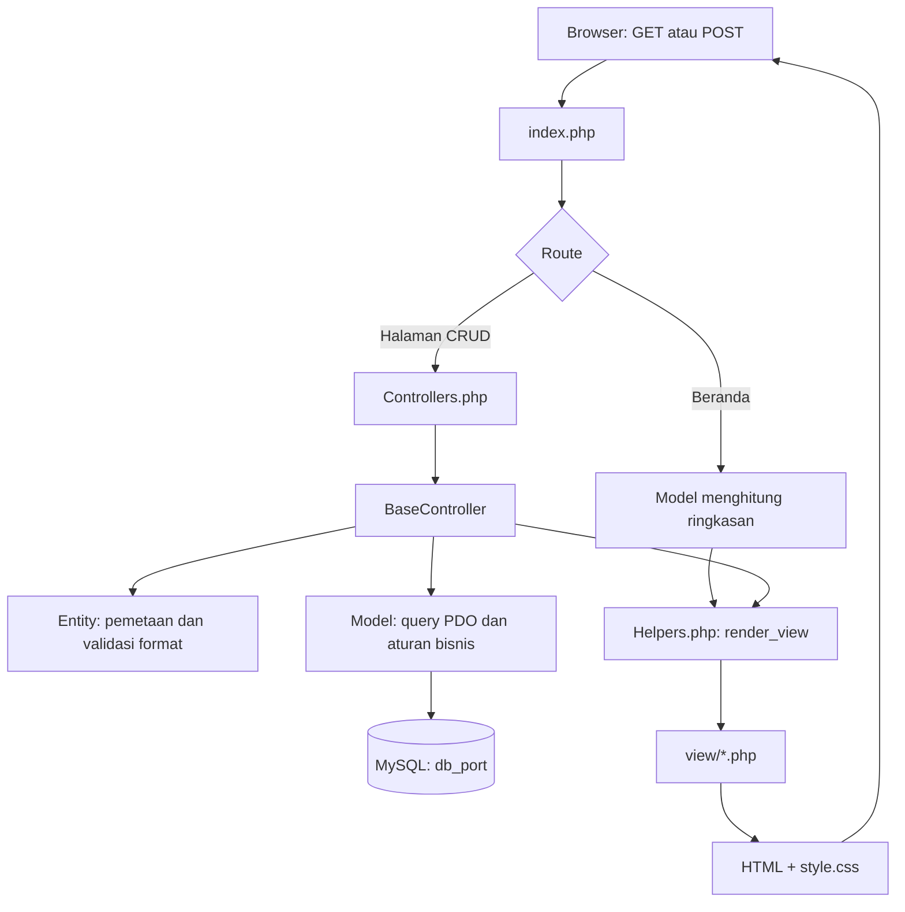

# PortExim: Sistem Ekspor Impor Pelabuhan

PortExim adalah aplikasi web praktikum untuk mencatat kapal, barang, pelabuhan, dan pengiriman ekspor-impor. Aplikasi dibuat dengan PHP native, pemrograman berorientasi objek, MySQL, dan PDO tanpa framework eksternal.

## Janji
```
Saya Mohammad Arya Dhinata dengan NIM 2504992 mengerjakan Tugas Praktikum 7 dalam mata kuliah Desain
Pemrograman Berbasis Objek untuk keberkahan-Nya maka saya tidak melakukan kecurangan seperti
yang di spesifikasikan. Aamiin
```

## Tema Website

Tema aplikasi adalah dashboard operasional pelabuhan. Beranda menampilkan jumlah kapal, barang, ekspor, dan impor. Menu Kapal, Barang, Pelabuhan, dan Transaksi menyediakan tabel serta formulir tambah/ubah. Form tambah disembunyikan hingga pengguna memilih kontrolnya; form edit terbuka otomatis. Tabel transaksi menampilkan rute, muatan, tanggal, jenis, dan status.

Antarmuka menggunakan tata letak sederhana, warna hijau pelabuhan, dan tampilan responsif. Tabel lebar dapat digulir secara horizontal di layar kecil.

## Teknologi dan Struktur

- PHP 8.0 atau lebih baru, tanpa framework.
- MySQL/MariaDB melalui PDO (`pdo_mysql`).
- HTML dan CSS tanpa dependensi frontend tambahan.

```text
index.php                 bootstrap aplikasi, routing, dan layout
class/
  BaseController.php      alur CRUD dan pagination bersama
  Controllers.php         controller kapal, barang, pelabuhan, transaksi
  BaseModel.php           akses query PDO dan penanganan error model
  Ship.php                model kapal
  Cargo.php               model barang
  Port.php                model pelabuhan
  Shipment.php            model transaksi dan validasi aturan bisnis
  *Entity.php             data entity dan validasi format input
  Helpers.php             escape, CSRF, render view, dan helper form
config/
  config.php              konfigurasi database, timezone, dan pagination
  db.php                  koneksi PDO bersama
database/
  db_port.sql             skema tabel dan data contoh
view/                     halaman dan template HTML/PHP
style.css                 gaya dan tata letak responsif
```

## Database

Database bernama `db_port`. Semua tabel memiliki `id`, `created_at`, dan `updated_at`.

| Tabel | Kolom utama | Keterangan |
|---|---|---|
| `ships` | `name`, `imo_number`, `flag_country`, `capacity_teu` | Kapal dan kapasitas peti kemas dalam TEU. `imo_number` harus unik. |
| `cargos` | `name`, `hs_code`, `category` | Barang/komoditas. `hs_code` harus unik. |
| `ports` | `name`, `country` | Pelabuhan; pasangan nama dan negara harus unik. Negara `Indonesia` dianggap domestik. |
| `shipments` | `ship_id`, `cargo_id`, `type`, `origin_port_id`, `destination_port_id`, `quantity_ton`, `shipment_date`, `status` | Pengiriman kapal dan barang dari pelabuhan asal ke tujuan. Muatan disimpan dalam ton. |

Relasi `shipments.ship_id` mengarah ke `ships.id`, `cargo_id` ke `cargos.id`, serta `origin_port_id` dan `destination_port_id` ke `ports.id`. Foreign key menggunakan `ON DELETE RESTRICT`; data referensi yang masih dipakai transaksi tidak dapat dihapus.

Jenis transaksi dan status menggunakan ENUM yang didefinisikan di skema SQL. Model membaca pilihan ENUM dari database agar pilihan formulir mengikuti skema.

## Aturan Bisnis

- Ekspor harus berangkat dari pelabuhan Indonesia menuju luar negeri; impor harus berangkat dari luar negeri menuju Indonesia.
- Pelabuhan asal dan tujuan harus berbeda.
- Muatan tidak boleh lebih dari kapasitas kapal, dengan asumsi maksimum `24 ton × kapasitas TEU`.
- Kapasitas kapal tidak dapat diturunkan di bawah muatan transaksi yang sudah terdaftar.
- Pengiriman bertanggal di masa depan hanya boleh berstatus `Menunggu`.
- Nomor IMO harus berisi 7 digit; kode HS harus berisi 6–10 digit.

## Alur Kode



1. `index.php` memuat konfigurasi, memulai sesi, dan memilih halaman dari daftar route yang diizinkan.
2. Beranda membaca jumlah data dari model. Halaman lain menjalankan controller yang sesuai.
3. `BaseController` menangani aksi tambah, ubah, hapus, pemuatan data edit, dan pagination. POST yang berhasil menggunakan pola Post/Redirect/Get.
4. Entity mengubah array database/form menjadi objek dan memvalidasi format. Model menjalankan prepared statement melalui koneksi PDO bersama serta memeriksa aturan bisnis yang membutuhkan database.
5. Controller mengirim data ke `render_view()`. View menampilkan data dan helper membuat elemen form; view tidak menjalankan query database.

## Menjalankan Aplikasi

### Kebutuhan

- PHP 8.0+ dengan ekstensi `pdo_mysql`.
- MySQL atau MariaDB yang sedang berjalan.

### Langkah Menjalankan

1. Simpan proyek di folder web server, misalnya `C:\laragon\www\TP7DPBO2526C2` atau `htdocs` pada XAMPP.
2. Buat/reset database dengan mengimpor `database/db_port.sql` melalui phpMyAdmin atau klien MySQL.
3. Periksa host, port, nama database, username, dan password di `config/config.php`. Nilai default: `localhost:3306`, database `db_port`, user `root`, password kosong. Nilai dapat ditimpa dengan `DB_HOST`, `DB_PORT`, `DB_NAME`, `DB_USER`, dan `DB_PASS`.
4. Jalankan melalui Apache/Laragon/XAMPP atau dari folder proyek melalui PHP development server:

   ```powershell
   php -S 127.0.0.1:8000 -t .
   ```

5. Buka `http://127.0.0.1:8000` atau alamat folder proyek pada web server yang digunakan.